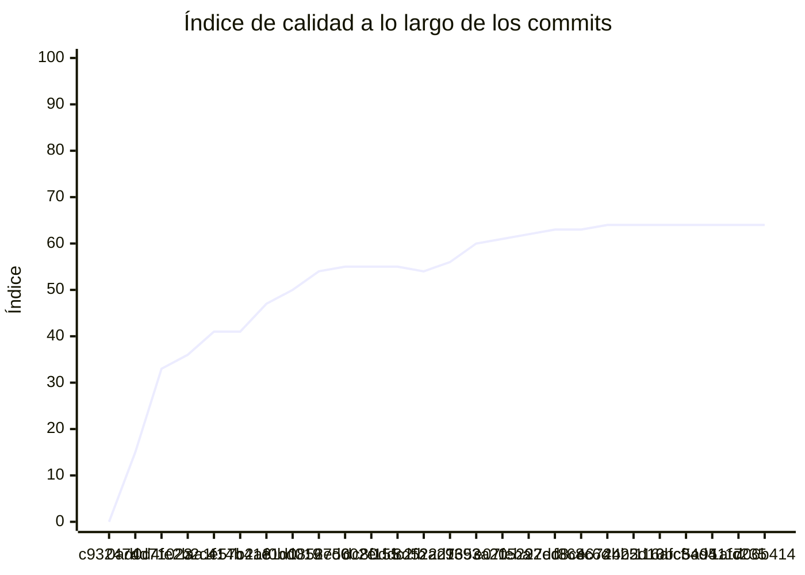

<!-- evaluacion:inicio -->
# Evaluación — mmachinea-pr2/turnos-catalog-service

> Documento **generado automáticamente** por la cátedra de Programación II (UM): RepoSense + análisis de calidad de **7 dimensiones**. **No editar a mano**: se regenera en cada evaluación.
> Rama evaluada: `main`. Análisis **heurístico** (regex + métricas) + build: es una criba para orientar la revisión, **no una nota**. La **documentación** del repositorio no se evalúa.
> Generado: 2026-11-11.

## 1. Veredicto

| Aspecto | Resultado |
|---|---|
| Índice de calidad | **75/100** |
| Tipo de repositorio | `backend` |
| Build (`mvnw verify` / `gradlew check`) | OK |
| Código (LOC) | 5,219 |
| Archivos de código | 130 |
| Clases | 134 |
| Código dentro de clases (%POO) | 81% |
| Funciones fuera de clases | 0 |
| Duplicación (puerta) | 2.2% |
| Duplicación lógica | 2.2% |
| Duplicación de boilerplate | 1.0% |
| Cobertura | 100% |

> Este informe **describe** lo que el análisis midió con los criterios ya establecidos de la materia. No es una nota.

## 2. Semáforo de aprobación

Criterios de la cátedra (`CRITERIOS-CALIDAD.md`): **Aprobar** se juega con el perfil `estandar`; **destacar**, con el `exigente` (meta de excelencia).

| Semáforo | Resultado |
|---|---|
| Aprobar (`estandar`) | **no cumple** — 7/11 |
| Destacar (`exigente`) | **no cumple** — 6/11 |

**Para aprobar, falta cumplir:** SOLID

**Para destacar, falta cumplir:** SOLID; Duplicación

## 3. Autoría (RepoSense)

| Autor | Commits | Código (LOC) | Tests (LOC) | Docs (LOC) | Días activos | % del código |
|---|---:|---:|---:|---:|---:|---:|
| pilarmachinea | 35 | 2,352 | 3,504 | 1,981 | 15 | 100% |

> _El LOC de autoría lo calcula RepoSense sobre el historial y puede diferir del LOC de código del análisis (que mira el estado de `main`)._

## 4. Dimensiones evaluadas

Cada dimensión indica **qué mide**, **por qué importa** y **tu resultado**. Cuando el puntaje queda por debajo de la referencia, se agregan preguntas para **investigar la causa** (no hay recetas).

| Dimensión | Peso | Puntaje |
|:--|--:|--:|
| **D1** Diseño OO, SOLID y patrones (20%) | 20% | 2 |
| **D2** Arquitectura hexagonal — backend (15%) | 15% | 100 |
| **D3** Frontend KMP: MVVM y buenas prácticas (10%) | 10% | N/A |
| **D4** Integración y contrato (10%) | 10% | 70 |
| **D5** Seguridad y robustez (10%) | 10% | 100 |
| **D6** Pruebas y cobertura (20%) | 20% | 100 |
| **D7** Proceso y entrega (15%) | 15% | 100 |

### D1. Diseño OO, SOLID y patrones (20%)

- **Qué mide:** Métricas orientadas a objetos (clases, métodos, campos, cohesión, acoplamiento, herencia) y proxies de SOLID, más patrones de diseño.
- **Por qué importa:** El eje de la materia es el buen uso de la POO y su arquitectura: un diseño con clases claras y poco acopladas es más fácil de entender, probar y cambiar.
- **Tu resultado:** **2/100**
- **Para investigar la causa:**
    - ¿Se pensó el modelo de clases antes de codificar o se agrupó después?
    - ¿Qué clases concentran muchas responsabilidades a la vez?
    - ¿Los colaboradores llegan como parámetros o se crean por dentro?

### D2. Arquitectura hexagonal — backend (15%)

- **Qué mide:** Separación en capas (dominio, puertos de entrada/salida, adaptadores) y dirección de las dependencias del backend.
- **Por qué importa:** Aislar el dominio de la infraestructura permite cambiar la base de datos, el framework o el transporte sin tocar las reglas de negocio.
- **Tu resultado:** **100/100**

### D4. Integración y contrato (10%)

- **Qué mide:** Cumplimiento del contrato de integración de la cátedra (formato de errores, paginación, autenticación, endpoints esperados).
- **Por qué importa:** Los servicios deben poder integrarse entre sí y con la app sin sorpresas; el contrato es lo que hacen cumplir las pruebas de integración.
- **Tu resultado:** **70/100**

### D5. Seguridad y robustez (10%)

- **Qué mide:** Credenciales embebidas, consultas SQL por concatenación, y presencia de config de entorno; aislamiento de secretos.
- **Por qué importa:** Un secreto en el repositorio o una consulta construida por concatenación son riesgos concretos, no hipotéticos.
- **Tu resultado:** **100/100**

### D6. Pruebas y cobertura (20%)

- **Qué mide:** Cantidad y resultado de pruebas y cobertura de línea (JaCoCo/Kover, Surefire/Failsafe) cuando hay build.
- **Por qué importa:** Las pruebas son la red de seguridad para refactorizar e integrar; la cobertura acota las zonas sin verificar.
- **Tu resultado:** **100/100**

### D7. Proceso y entrega (15%)

- **Qué mide:** Artefactos verificables de proceso/entrega: `compose`, `.env.example`, CI (`.github/workflows/`), `CODEOWNERS` y wrapper de build (`mvnw`/`gradlew`). **No** puntúa documentación.
- **Por qué importa:** Un proyecto que compila, se levanta y se valida solo es más fácil de revisar y de integrar en equipo.
- **Tu resultado:** **100/100**

## 5. Señales detectadas

El análisis encontró las siguientes señales (archivo, sin número de línea a propósito):

**DIP/concretos** (101)
- clase 'JwtSettings' muy acoplada (CBO=8) — `src/main/java/ar/edu/programacion2/catalog/security/JwtSettings.java`
- clase 'JwtSettings' instancia 3 concretos (CBO=8) — `src/main/java/ar/edu/programacion2/catalog/security/JwtSettings.java`
- clase 'SecurityConfiguration' muy acoplada (CBO=29) — `src/main/java/ar/edu/programacion2/catalog/security/SecurityConfiguration.java`
- clase 'SecurityConfiguration' instancia 6 concretos (CBO=29) — `src/main/java/ar/edu/programacion2/catalog/security/SecurityConfiguration.java`
- clase 'RedisCatalogVersionSource' muy acoplada (CBO=9) — `src/main/java/ar/edu/programacion2/catalog/catalog/infrastructure/redis/RedisCatalogVersionSource.java`
- clase 'RedisCatalogVersionSource' instancia 3 concretos (CBO=9) — `src/main/java/ar/edu/programacion2/catalog/catalog/infrastructure/redis/RedisCatalogVersionSource.java`
- clase 'RedisCatalogEntityParser' muy acoplada (CBO=17) — `src/main/java/ar/edu/programacion2/catalog/catalog/infrastructure/redis/RedisCatalogEntityParser.java`
- clase 'RedisCatalogEntityParser' instancia 9 concretos (CBO=17) — `src/main/java/ar/edu/programacion2/catalog/catalog/infrastructure/redis/RedisCatalogEntityParser.java`
- clase 'RedisCatalogChangesSource' muy acoplada (CBO=17) — `src/main/java/ar/edu/programacion2/catalog/catalog/infrastructure/redis/RedisCatalogChangesSource.java`
- clase 'RedisCatalogChangesSource' instancia 6 concretos (CBO=17) — `src/main/java/ar/edu/programacion2/catalog/catalog/infrastructure/redis/RedisCatalogChangesSource.java`
- clase 'RedisCatalogEntitiesSource' muy acoplada (CBO=13) — `src/main/java/ar/edu/programacion2/catalog/catalog/infrastructure/redis/RedisCatalogEntitiesSource.java`
- clase 'RedisCatalogEntitiesSource' instancia 4 concretos (CBO=13) — `src/main/java/ar/edu/programacion2/catalog/catalog/infrastructure/redis/RedisCatalogEntitiesSource.java`
- clase 'CatalogRedisConfiguration' muy acoplada (CBO=14) — `src/main/java/ar/edu/programacion2/catalog/catalog/infrastructure/redis/CatalogRedisConfiguration.java`
- clase 'CatalogRedisConfiguration' instancia 5 concretos (CBO=14) — `src/main/java/ar/edu/programacion2/catalog/catalog/infrastructure/redis/CatalogRedisConfiguration.java`
- clase 'ManualFullCatalogSynchronization' muy acoplada (CBO=20) — `src/main/java/ar/edu/programacion2/catalog/catalog/infrastructure/startup/ManualFullCatalogSynchronization.java`
- clase 'ManualFullCatalogSynchronization' instancia 5 concretos (CBO=20) — `src/main/java/ar/edu/programacion2/catalog/catalog/infrastructure/startup/ManualFullCatalogSynchronization.java`
- clase 'ManualCatalogSynchronization' muy acoplada (CBO=13) — `src/main/java/ar/edu/programacion2/catalog/catalog/infrastructure/startup/ManualCatalogSynchronization.java`
- clase 'RestCatalogSnapshotSource' muy acoplada (CBO=15) — `src/main/java/ar/edu/programacion2/catalog/catalog/infrastructure/rest/RestCatalogSnapshotSource.java`
- clase 'RestCatalogSnapshotSource' instancia 3 concretos (CBO=15) — `src/main/java/ar/edu/programacion2/catalog/catalog/infrastructure/rest/RestCatalogSnapshotSource.java`
- clase 'CatalogRestConfiguration' muy acoplada (CBO=14) — `src/main/java/ar/edu/programacion2/catalog/catalog/infrastructure/rest/CatalogRestConfiguration.java`
- clase 'CatalogRestConfiguration' instancia 5 concretos (CBO=14) — `src/main/java/ar/edu/programacion2/catalog/catalog/infrastructure/rest/CatalogRestConfiguration.java`
- clase 'CatalogSynchronizationSchedule' muy acoplada (CBO=10) — `src/main/java/ar/edu/programacion2/catalog/catalog/infrastructure/scheduling/CatalogSynchronizationSchedule.java`
- clase 'CatalogSynchronizationSchedule' instancia 3 concretos (CBO=10) — `src/main/java/ar/edu/programacion2/catalog/catalog/infrastructure/scheduling/CatalogSynchronizationSchedule.java`
- clase 'PeriodicCatalogSynchronization' muy acoplada (CBO=9) — `src/main/java/ar/edu/programacion2/catalog/catalog/infrastructure/scheduling/PeriodicCatalogSynchronization.java`
- clase 'JpaCatalogIncrementStore' muy acoplada (CBO=12) — `src/main/java/ar/edu/programacion2/catalog/catalog/infrastructure/persistence/JpaCatalogIncrementStore.java`
- clase 'JpaCatalogIncrementStore' instancia 3 concretos (CBO=12) — `src/main/java/ar/edu/programacion2/catalog/catalog/infrastructure/persistence/JpaCatalogIncrementStore.java`
- clase 'JdbcProcessedCatalogEventStore' muy acoplada (CBO=17) — `src/main/java/ar/edu/programacion2/catalog/catalog/infrastructure/persistence/JdbcProcessedCatalogEventStore.java`
- clase 'JdbcProcessedCatalogEventStore' instancia 3 concretos (CBO=17) — `src/main/java/ar/edu/programacion2/catalog/catalog/infrastructure/persistence/JdbcProcessedCatalogEventStore.java`
- clase 'JpaCatalogSnapshotStore' muy acoplada (CBO=11) — `src/main/java/ar/edu/programacion2/catalog/catalog/infrastructure/persistence/JpaCatalogSnapshotStore.java`
- clase 'CatalogKafkaConfiguration' muy acoplada (CBO=23) — `src/main/java/ar/edu/programacion2/catalog/catalog/infrastructure/messaging/CatalogKafkaConfiguration.java`
- clase 'CatalogKafkaConfiguration' instancia 5 concretos (CBO=23) — `src/main/java/ar/edu/programacion2/catalog/catalog/infrastructure/messaging/CatalogKafkaConfiguration.java`
- clase 'CatalogKafkaListener' muy acoplada (CBO=11) — `src/main/java/ar/edu/programacion2/catalog/catalog/infrastructure/messaging/CatalogKafkaListener.java`
- clase 'CatalogKafkaListener' instancia 3 concretos (CBO=11) — `src/main/java/ar/edu/programacion2/catalog/catalog/infrastructure/messaging/CatalogKafkaListener.java`
- clase 'CatalogUpdatedEventDecoder' muy acoplada (CBO=13) — `src/main/java/ar/edu/programacion2/catalog/catalog/infrastructure/messaging/CatalogUpdatedEventDecoder.java`
- clase 'CatalogUpdatedEventDecoder' instancia 7 concretos (CBO=13) — `src/main/java/ar/edu/programacion2/catalog/catalog/infrastructure/messaging/CatalogUpdatedEventDecoder.java`
- clase 'CatalogQueryConfiguration' muy acoplada (CBO=12) — `src/main/java/ar/edu/programacion2/catalog/catalog/infrastructure/configuration/CatalogQueryConfiguration.java`
- clase 'CatalogQueryConfiguration' instancia 4 concretos (CBO=12) — `src/main/java/ar/edu/programacion2/catalog/catalog/infrastructure/configuration/CatalogQueryConfiguration.java`
- clase 'CatalogRecoveryConfiguration' muy acoplada (CBO=8) — `src/main/java/ar/edu/programacion2/catalog/catalog/infrastructure/configuration/CatalogRecoveryConfiguration.java`
- clase 'CatalogSynchronizationDecisionConfiguration' muy acoplada (CBO=9) — `src/main/java/ar/edu/programacion2/catalog/catalog/infrastructure/configuration/CatalogSynchronizationDecisionConfiguration.java`
- clase 'ProfessionalController' muy acoplada (CBO=11) — `src/main/java/ar/edu/programacion2/catalog/catalog/infrastructure/web/ProfessionalController.java`
- clase 'ProfessionalController' instancia 4 concretos (CBO=11) — `src/main/java/ar/edu/programacion2/catalog/catalog/infrastructure/web/ProfessionalController.java`
- clase 'SynchronizeCatalogIncrementService' muy acoplada (CBO=22) — `src/main/java/ar/edu/programacion2/catalog/catalog/application/service/SynchronizeCatalogIncrementService.java`
- clase 'SynchronizeCatalogIncrementService' instancia 3 concretos (CBO=22) — `src/main/java/ar/edu/programacion2/catalog/catalog/application/service/SynchronizeCatalogIncrementService.java`
- clase 'SynchronizeCatalogService' muy acoplada (CBO=13) — `src/main/java/ar/edu/programacion2/catalog/catalog/application/service/SynchronizeCatalogService.java`
- clase 'DetermineCatalogSynchronizationService' muy acoplada (CBO=10) — `src/main/java/ar/edu/programacion2/catalog/catalog/application/service/DetermineCatalogSynchronizationService.java`
- clase 'HandleCatalogUpdatedService' muy acoplada (CBO=11) — `src/main/java/ar/edu/programacion2/catalog/catalog/application/service/HandleCatalogUpdatedService.java`
- clase 'CatalogChangedEntities' muy acoplada (CBO=8) — `src/main/java/ar/edu/programacion2/catalog/catalog/application/model/CatalogChangedEntities.java`
- clase 'CatalogSnapshot' muy acoplada (CBO=10) — `src/main/java/ar/edu/programacion2/catalog/catalog/domain/model/CatalogSnapshot.java`
- clase 'CatalogSnapshot' instancia 4 concretos (CBO=10) — `src/main/java/ar/edu/programacion2/catalog/catalog/domain/model/CatalogSnapshot.java`
- clase 'ManualFullCatalogSynchronizationIntegrationTests' muy acoplada (CBO=30) — `src/test/java/ar/edu/programacion2/catalog/ManualFullCatalogSynchronizationIntegrationTests.java`
- clase 'ManualFullCatalogSynchronizationIntegrationTests' instancia 5 concretos (CBO=30) — `src/test/java/ar/edu/programacion2/catalog/ManualFullCatalogSynchronizationIntegrationTests.java`
- clase 'ManualCatalogSynchronizationIntegrationTests' muy acoplada (CBO=25) — `src/test/java/ar/edu/programacion2/catalog/ManualCatalogSynchronizationIntegrationTests.java`
- clase 'ManualCatalogSynchronizationIntegrationTests' instancia 6 concretos (CBO=25) — `src/test/java/ar/edu/programacion2/catalog/ManualCatalogSynchronizationIntegrationTests.java`
- clase 'CatalogSnapshotPersistenceTests' muy acoplada (CBO=88) — `src/test/java/ar/edu/programacion2/catalog/CatalogSnapshotPersistenceTests.java`
- clase 'CatalogSnapshotPersistenceTests' instancia 42 concretos (CBO=88) — `src/test/java/ar/edu/programacion2/catalog/CatalogSnapshotPersistenceTests.java`
- clase 'CatalogApplicationTests' muy acoplada (CBO=98) — `src/test/java/ar/edu/programacion2/catalog/CatalogApplicationTests.java`
- clase 'CatalogApplicationTests' instancia 50 concretos (CBO=98) — `src/test/java/ar/edu/programacion2/catalog/CatalogApplicationTests.java`
- clase 'JwtSettingsTests' muy acoplada (CBO=8) — `src/test/java/ar/edu/programacion2/catalog/security/JwtSettingsTests.java`
- clase 'JwtSettingsTests' instancia 7 concretos (CBO=8) — `src/test/java/ar/edu/programacion2/catalog/security/JwtSettingsTests.java`
- clase 'CatalogSecurityTests' muy acoplada (CBO=28) — `src/test/java/ar/edu/programacion2/catalog/security/CatalogSecurityTests.java`
- clase 'RedisCatalogEntitiesSourceTests' muy acoplada (CBO=25) — `src/test/java/ar/edu/programacion2/catalog/catalog/infrastructure/redis/RedisCatalogEntitiesSourceTests.java`
- clase 'RedisCatalogEntitiesSourceTests' instancia 9 concretos (CBO=25) — `src/test/java/ar/edu/programacion2/catalog/catalog/infrastructure/redis/RedisCatalogEntitiesSourceTests.java`
- clase 'RedisCatalogChangesSourceTests' muy acoplada (CBO=18) — `src/test/java/ar/edu/programacion2/catalog/catalog/infrastructure/redis/RedisCatalogChangesSourceTests.java`
- clase 'RedisCatalogChangesSourceTests' instancia 9 concretos (CBO=18) — `src/test/java/ar/edu/programacion2/catalog/catalog/infrastructure/redis/RedisCatalogChangesSourceTests.java`
- clase 'RedisCatalogVersionSourceTests' muy acoplada (CBO=19) — `src/test/java/ar/edu/programacion2/catalog/catalog/infrastructure/redis/RedisCatalogVersionSourceTests.java`
- clase 'RedisCatalogVersionSourceTests' instancia 8 concretos (CBO=19) — `src/test/java/ar/edu/programacion2/catalog/catalog/infrastructure/redis/RedisCatalogVersionSourceTests.java`
- clase 'ManualCatalogSynchronizationTests' muy acoplada (CBO=10) — `src/test/java/ar/edu/programacion2/catalog/catalog/infrastructure/startup/ManualCatalogSynchronizationTests.java`
- clase 'ManualCatalogSynchronizationTests' instancia 8 concretos (CBO=10) — `src/test/java/ar/edu/programacion2/catalog/catalog/infrastructure/startup/ManualCatalogSynchronizationTests.java`
- clase 'ManualFullCatalogSynchronizationTests' muy acoplada (CBO=15) — `src/test/java/ar/edu/programacion2/catalog/catalog/infrastructure/startup/ManualFullCatalogSynchronizationTests.java`
- clase 'ManualFullCatalogSynchronizationTests' instancia 7 concretos (CBO=15) — `src/test/java/ar/edu/programacion2/catalog/catalog/infrastructure/startup/ManualFullCatalogSynchronizationTests.java`
- clase 'RestCatalogSnapshotSourceTests' muy acoplada (CBO=22) — `src/test/java/ar/edu/programacion2/catalog/catalog/infrastructure/rest/RestCatalogSnapshotSourceTests.java`
- clase 'RestCatalogSnapshotSourceTests' instancia 3 concretos (CBO=22) — `src/test/java/ar/edu/programacion2/catalog/catalog/infrastructure/rest/RestCatalogSnapshotSourceTests.java`
- clase 'PeriodicCatalogConfigurationTests' muy acoplada (CBO=16) — `src/test/java/ar/edu/programacion2/catalog/catalog/infrastructure/scheduling/PeriodicCatalogConfigurationTests.java`
- clase 'PeriodicCatalogConfigurationTests' instancia 8 concretos (CBO=16) — `src/test/java/ar/edu/programacion2/catalog/catalog/infrastructure/scheduling/PeriodicCatalogConfigurationTests.java`
- clase 'PeriodicCatalogSynchronizationTests' muy acoplada (CBO=13) — `src/test/java/ar/edu/programacion2/catalog/catalog/infrastructure/scheduling/PeriodicCatalogSynchronizationTests.java`
- clase 'PeriodicCatalogSynchronizationTests' instancia 8 concretos (CBO=13) — `src/test/java/ar/edu/programacion2/catalog/catalog/infrastructure/scheduling/PeriodicCatalogSynchronizationTests.java`
- clase 'CatalogPersistenceMapperTests' muy acoplada (CBO=12) — `src/test/java/ar/edu/programacion2/catalog/catalog/infrastructure/persistence/CatalogPersistenceMapperTests.java`
- clase 'CatalogPersistenceMapperTests' instancia 4 concretos (CBO=12) — `src/test/java/ar/edu/programacion2/catalog/catalog/infrastructure/persistence/CatalogPersistenceMapperTests.java`
- clase 'CatalogKafkaListenerTests' muy acoplada (CBO=13) — `src/test/java/ar/edu/programacion2/catalog/catalog/infrastructure/messaging/CatalogKafkaListenerTests.java`
- clase 'CatalogKafkaConfigurationTests' muy acoplada (CBO=9) — `src/test/java/ar/edu/programacion2/catalog/catalog/infrastructure/messaging/CatalogKafkaConfigurationTests.java`
- clase 'CatalogUpdatedEventDecoderTests' muy acoplada (CBO=8) — `src/test/java/ar/edu/programacion2/catalog/catalog/infrastructure/messaging/CatalogUpdatedEventDecoderTests.java`
- clase 'CatalogKafkaIntegrationTests' muy acoplada (CBO=28) — `src/test/java/ar/edu/programacion2/catalog/catalog/infrastructure/messaging/CatalogKafkaIntegrationTests.java`
- clase 'CatalogKafkaIntegrationTests' instancia 12 concretos (CBO=28) — `src/test/java/ar/edu/programacion2/catalog/catalog/infrastructure/messaging/CatalogKafkaIntegrationTests.java`
- clase 'CatalogRecoveryConfigurationTests' muy acoplada (CBO=8) — `src/test/java/ar/edu/programacion2/catalog/catalog/infrastructure/configuration/CatalogRecoveryConfigurationTests.java`
- clase 'CatalogSynchronizationDecisionConfigurationTests' muy acoplada (CBO=13) — `src/test/java/ar/edu/programacion2/catalog/catalog/infrastructure/configuration/CatalogSynchronizationDecisionConfigurationTests.java`
- clase 'CatalogSynchronizationDecisionConfigurationTests' instancia 3 concretos (CBO=13) — `src/test/java/ar/edu/programacion2/catalog/catalog/infrastructure/configuration/CatalogSynchronizationDecisionConfigurationTests.java`
- clase 'CatalogSynchronizationConfigurationTests' muy acoplada (CBO=8) — `src/test/java/ar/edu/programacion2/catalog/catalog/infrastructure/configuration/CatalogSynchronizationConfigurationTests.java`
- clase 'HandleCatalogUpdatedServiceTests' muy acoplada (CBO=21) — `src/test/java/ar/edu/programacion2/catalog/catalog/application/service/HandleCatalogUpdatedServiceTests.java`
- clase 'HandleCatalogUpdatedServiceTests' instancia 11 concretos (CBO=21) — `src/test/java/ar/edu/programacion2/catalog/catalog/application/service/HandleCatalogUpdatedServiceTests.java`
- clase 'SynchronizeCatalogServiceTests' muy acoplada (CBO=17) — `src/test/java/ar/edu/programacion2/catalog/catalog/application/service/SynchronizeCatalogServiceTests.java`
- clase 'SynchronizeCatalogServiceTests' instancia 3 concretos (CBO=17) — `src/test/java/ar/edu/programacion2/catalog/catalog/application/service/SynchronizeCatalogServiceTests.java`
- clase 'SynchronizeCatalogIncrementServiceTests' muy acoplada (CBO=25) — `src/test/java/ar/edu/programacion2/catalog/catalog/application/service/SynchronizeCatalogIncrementServiceTests.java`
- clase 'SynchronizeCatalogIncrementServiceTests' instancia 21 concretos (CBO=25) — `src/test/java/ar/edu/programacion2/catalog/catalog/application/service/SynchronizeCatalogIncrementServiceTests.java`
- clase 'DetermineCatalogSynchronizationServiceTests' muy acoplada (CBO=11) — `src/test/java/ar/edu/programacion2/catalog/catalog/application/service/DetermineCatalogSynchronizationServiceTests.java`
- clase 'DetermineCatalogSynchronizationServiceTests' instancia 12 concretos (CBO=11) — `src/test/java/ar/edu/programacion2/catalog/catalog/application/service/DetermineCatalogSynchronizationServiceTests.java`
- clase 'CatalogChangedEntitiesTests' muy acoplada (CBO=9) — `src/test/java/ar/edu/programacion2/catalog/catalog/application/model/CatalogChangedEntitiesTests.java`
- clase 'CatalogChangedEntitiesTests' instancia 9 concretos (CBO=9) — `src/test/java/ar/edu/programacion2/catalog/catalog/application/model/CatalogChangedEntitiesTests.java`
- clase 'CatalogSnapshotTests' muy acoplada (CBO=14) — `src/test/java/ar/edu/programacion2/catalog/catalog/domain/model/CatalogSnapshotTests.java`
- clase 'CatalogSnapshotTests' instancia 13 concretos (CBO=14) — `src/test/java/ar/edu/programacion2/catalog/catalog/domain/model/CatalogSnapshotTests.java`
- clase 'CatalogDomainTests' muy acoplada (CBO=11) — `src/test/java/ar/edu/programacion2/catalog/catalog/domain/model/CatalogDomainTests.java`
- clase 'CatalogDomainTests' instancia 5 concretos (CBO=11) — `src/test/java/ar/edu/programacion2/catalog/catalog/domain/model/CatalogDomainTests.java`

**OCP/type-switch** (1)
- clase 'SecurityConfiguration' con 1 type-checks — `src/main/java/ar/edu/programacion2/catalog/security/SecurityConfiguration.java`

**SRP/responsabilidad** (47)
- clase 'RedisCatalogEntityParser' grande (LOC=62, métodos=13, campos=0) — `src/main/java/ar/edu/programacion2/catalog/catalog/infrastructure/redis/RedisCatalogEntityParser.java`
- método 'ManualFullCatalogSynchronization.run' con complejidad 9 — `src/main/java/ar/edu/programacion2/catalog/catalog/infrastructure/startup/ManualFullCatalogSynchronization.java`
- clase 'CatalogSyncStateEntity' con baja cohesión (20%) — `src/main/java/ar/edu/programacion2/catalog/catalog/infrastructure/persistence/CatalogSyncStateEntity.java`
- clase 'ProfessionalCategoryEntity' con baja cohesión (21%) — `src/main/java/ar/edu/programacion2/catalog/catalog/infrastructure/persistence/ProfessionalCategoryEntity.java`
- método 'ProfessionalCategoryEntity.ProfessionalCategoryEntity' con 6 parámetros — `src/main/java/ar/edu/programacion2/catalog/catalog/infrastructure/persistence/ProfessionalCategoryEntity.java`
- clase 'WeeklyScheduleEntity' grande (LOC=44, métodos=11, campos=9) — `src/main/java/ar/edu/programacion2/catalog/catalog/infrastructure/persistence/WeeklyScheduleEntity.java`
- clase 'WeeklyScheduleEntity' con baja cohesión (16%) — `src/main/java/ar/edu/programacion2/catalog/catalog/infrastructure/persistence/WeeklyScheduleEntity.java`
- método 'WeeklyScheduleEntity.WeeklyScheduleEntity' con 9 parámetros — `src/main/java/ar/edu/programacion2/catalog/catalog/infrastructure/persistence/WeeklyScheduleEntity.java`
- clase 'ProfessionalEntity' con baja cohesión (19%) — `src/main/java/ar/edu/programacion2/catalog/catalog/infrastructure/persistence/ProfessionalEntity.java`
- método 'ProfessionalEntity.ProfessionalEntity' con 7 parámetros — `src/main/java/ar/edu/programacion2/catalog/catalog/infrastructure/persistence/ProfessionalEntity.java`
- clase 'SynchronizeCatalogIncrementService' con baja cohesión (0%) — `src/main/java/ar/edu/programacion2/catalog/catalog/application/service/SynchronizeCatalogIncrementService.java`
- método 'SynchronizeCatalogIncrementService.synchronize' de 35 líneas — `src/main/java/ar/edu/programacion2/catalog/catalog/application/service/SynchronizeCatalogIncrementService.java`
- método 'SynchronizeCatalogIncrementService.synchronize' con complejidad 10 — `src/main/java/ar/edu/programacion2/catalog/catalog/application/service/SynchronizeCatalogIncrementService.java`
- método 'SynchronizeCatalogService.synchronize' con complejidad 8 — `src/main/java/ar/edu/programacion2/catalog/catalog/application/service/SynchronizeCatalogService.java`
- método 'DetermineCatalogSynchronizationService.determine' con complejidad 6 — `src/main/java/ar/edu/programacion2/catalog/catalog/application/service/DetermineCatalogSynchronizationService.java`
- método 'HandleCatalogUpdatedService.handle' con complejidad 6 — `src/main/java/ar/edu/programacion2/catalog/catalog/application/service/HandleCatalogUpdatedService.java`
- método 'WeeklySchedule.WeeklySchedule' con 9 parámetros — `src/main/java/ar/edu/programacion2/catalog/catalog/domain/model/WeeklySchedule.java`
- método 'ProfessionalCategory.ProfessionalCategory' con 6 parámetros — `src/main/java/ar/edu/programacion2/catalog/catalog/domain/model/ProfessionalCategory.java`
- método 'Professional.Professional' con 7 parámetros — `src/main/java/ar/edu/programacion2/catalog/catalog/domain/model/Professional.java`
- método 'ManualFullCatalogSynchronizationIntegrationTests.commandRunsSnapshotIncrementRecoveryAndPreservesDataOnFailure' de 64 líneas — `src/test/java/ar/edu/programacion2/catalog/ManualFullCatalogSynchronizationIntegrationTests.java`
- método 'ManualCatalogSynchronizationIntegrationTests.explicitCommandLoadsCatalogOnceAndKeepsItWhenServerFails' de 47 líneas — `src/test/java/ar/edu/programacion2/catalog/ManualCatalogSynchronizationIntegrationTests.java`
- clase 'CatalogSnapshotPersistenceTests' grande (LOC=412, métodos=31, campos=2) — `src/test/java/ar/edu/programacion2/catalog/CatalogSnapshotPersistenceTests.java`
- método 'CatalogSnapshotPersistenceTests.coordinatorReadsOutsideTransactionAndAppliesThroughRealStore' de 37 líneas — `src/test/java/ar/edu/programacion2/catalog/CatalogSnapshotPersistenceTests.java`
- clase 'CatalogApplicationTests' grande (LOC=439, métodos=39, campos=2) — `src/test/java/ar/edu/programacion2/catalog/CatalogApplicationTests.java`
- método 'CatalogApplicationTests.professionalsEndpointFiltersCategoryAndLogicalDeletionsWithStableOrder' de 31 líneas — `src/test/java/ar/edu/programacion2/catalog/CatalogApplicationTests.java`
- método 'CatalogApplicationTests.scheduleEndpointReturnsOnlyEnabledAgendaInWeekAndTimeOrder' de 44 líneas — `src/test/java/ar/edu/programacion2/catalog/CatalogApplicationTests.java`
- método 'CatalogApplicationTests.schedule' con 6 parámetros — `src/test/java/ar/edu/programacion2/catalog/CatalogApplicationTests.java`
- método 'CatalogApplicationTests.WeeklyScheduleEntity' con 5 parámetros — `src/test/java/ar/edu/programacion2/catalog/CatalogApplicationTests.java`
- método 'CatalogApplicationTests.professionalsPaginationPreservesFiltersCountsAndStableOrder' de 43 líneas — `src/test/java/ar/edu/programacion2/catalog/CatalogApplicationTests.java`
- método 'CatalogApplicationTests.professionalsPaginationPreservesFiltersCountsAndStableOrder' con complejidad 6 — `src/test/java/ar/edu/programacion2/catalog/CatalogApplicationTests.java`
- método 'CatalogApplicationTests.ProfessionalCategoryEntity' con 5 parámetros — `src/test/java/ar/edu/programacion2/catalog/CatalogApplicationTests.java`
- clase 'CatalogSecurityTests' grande (LOC=78, métodos=15, campos=0) — `src/test/java/ar/edu/programacion2/catalog/security/CatalogSecurityTests.java`
- método 'CatalogSecurityTests.rejectsInvalidClaims' con complejidad 11 — `src/test/java/ar/edu/programacion2/catalog/security/CatalogSecurityTests.java`
- clase 'RedisCatalogEntitiesSourceTests' grande (LOC=151, métodos=22, campos=2) — `src/test/java/ar/edu/programacion2/catalog/catalog/infrastructure/redis/RedisCatalogEntitiesSourceTests.java`
- clase 'RedisCatalogChangesSourceTests' grande (LOC=112, métodos=16, campos=2) — `src/test/java/ar/edu/programacion2/catalog/catalog/infrastructure/redis/RedisCatalogChangesSourceTests.java`
- clase 'RedisCatalogVersionSourceTests' grande (LOC=80, métodos=11, campos=3) — `src/test/java/ar/edu/programacion2/catalog/catalog/infrastructure/redis/RedisCatalogVersionSourceTests.java`
- clase 'RedisCatalogVersionSourceTests' con baja cohesión (24%) — `src/test/java/ar/edu/programacion2/catalog/catalog/infrastructure/redis/RedisCatalogVersionSourceTests.java`
- clase 'ManualFullCatalogSynchronizationTests' grande (LOC=66, métodos=10, campos=0) — `src/test/java/ar/edu/programacion2/catalog/catalog/infrastructure/startup/ManualFullCatalogSynchronizationTests.java`
- clase 'RestCatalogSnapshotSourceTests' grande (LOC=79, métodos=11, campos=3) — `src/test/java/ar/edu/programacion2/catalog/catalog/infrastructure/rest/RestCatalogSnapshotSourceTests.java`
- clase 'PeriodicCatalogConfigurationTests' grande (LOC=73, métodos=10, campos=0) — `src/test/java/ar/edu/programacion2/catalog/catalog/infrastructure/scheduling/PeriodicCatalogConfigurationTests.java`
- clase 'CatalogKafkaIntegrationTests' grande (LOC=91, métodos=14, campos=1) — `src/test/java/ar/edu/programacion2/catalog/catalog/infrastructure/messaging/CatalogKafkaIntegrationTests.java`
- método 'CatalogKafkaIntegrationTests.commitsSuccessAndDuplicatesButRedeliversFailureAfterRestart' de 44 líneas — `src/test/java/ar/edu/programacion2/catalog/catalog/infrastructure/messaging/CatalogKafkaIntegrationTests.java`
- método 'CatalogKafkaIntegrationTests.send' con 5 parámetros — `src/test/java/ar/edu/programacion2/catalog/catalog/infrastructure/messaging/CatalogKafkaIntegrationTests.java`
- clase 'SynchronizeCatalogIncrementServiceTests' grande (LOC=117, métodos=13, campos=8) — `src/test/java/ar/edu/programacion2/catalog/catalog/application/service/SynchronizeCatalogIncrementServiceTests.java`
- método 'SynchronizeCatalogIncrementServiceTests.ready' con complejidad 6 — `src/test/java/ar/edu/programacion2/catalog/catalog/application/service/SynchronizeCatalogIncrementServiceTests.java`
- método 'SynchronizeCatalogIncrementServiceTests.readFailuresNeverReachPersistence' con complejidad 10 — `src/test/java/ar/edu/programacion2/catalog/catalog/application/service/SynchronizeCatalogIncrementServiceTests.java`
- método 'CatalogSnapshotTests.rejectsMissingCollectionsAndNullMembers' con complejidad 7 — `src/test/java/ar/edu/programacion2/catalog/catalog/domain/model/CatalogSnapshotTests.java`

**duplicación** (6)
- duplicación lógica: 2.2% · boilerplate: 1.0%
- bloque de 8 líneas repetido 4 veces en src/test/java/ar/edu/programacion2/catalog/catalog/application/service/DetermineCatalogSynchronizationServiceTests.java:15, src/test/java/ar/edu/programacion2/catalog/catalog/application/service/DetermineCatalogSynchronizationServiceTests.java:16, src/test/java/ar/edu/programacion2/catalog/catalog/application/service/DetermineCatalogSynchronizationServiceTests.java:17 — `src/test/java/ar/edu/programacion2/catalog/catalog/application/service/DetermineCatalogSynchronizationServiceTests.java`
- bloque de 8 líneas repetido 4 veces en src/test/java/ar/edu/programacion2/catalog/ManualFullCatalogSynchronizationIntegrationTests.java:110, src/test/java/ar/edu/programacion2/catalog/catalog/infrastructure/redis/RedisCatalogEntitiesSourceTests.java:184, src/test/java/ar/edu/programacion2/catalog/catalog/infrastructure/redis/RedisCatalogChangesSourceTests.java:137 — `src/test/java/ar/edu/programacion2/catalog/ManualFullCatalogSynchronizationIntegrationTests.java`
- bloque de 8 líneas repetido 4 veces en src/test/java/ar/edu/programacion2/catalog/ManualFullCatalogSynchronizationIntegrationTests.java:108, src/test/java/ar/edu/programacion2/catalog/catalog/infrastructure/redis/RedisCatalogEntitiesSourceTests.java:182, src/test/java/ar/edu/programacion2/catalog/catalog/infrastructure/redis/RedisCatalogChangesSourceTests.java:135 — `src/test/java/ar/edu/programacion2/catalog/ManualFullCatalogSynchronizationIntegrationTests.java`
- bloque de 8 líneas repetido 3 veces en src/test/java/ar/edu/programacion2/catalog/catalog/infrastructure/redis/RedisCatalogEntitiesSourceTests.java:181, src/test/java/ar/edu/programacion2/catalog/catalog/infrastructure/redis/RedisCatalogChangesSourceTests.java:134, src/test/java/ar/edu/programacion2/catalog/catalog/infrastructure/redis/RedisCatalogVersionSourceTests.java:96 — `src/test/java/ar/edu/programacion2/catalog/catalog/infrastructure/redis/RedisCatalogEntitiesSourceTests.java`
- bloque de 8 líneas repetido 3 veces en src/test/java/ar/edu/programacion2/catalog/catalog/infrastructure/redis/RedisCatalogEntitiesSourceTests.java:179, src/test/java/ar/edu/programacion2/catalog/catalog/infrastructure/redis/RedisCatalogChangesSourceTests.java:132, src/test/java/ar/edu/programacion2/catalog/catalog/infrastructure/redis/RedisCatalogVersionSourceTests.java:94 — `src/test/java/ar/edu/programacion2/catalog/catalog/infrastructure/redis/RedisCatalogEntitiesSourceTests.java`

## 6. Evolución por commit

Métricas calculadas sobre el estado de `main` en **cada commit** (26 commits con trabajo), del primero al último. La calidad usa el perfil `exigente`; el aporte de código lo mide RepoSense. El índice puede **bajar** al crecer el proyecto: se acumulan señales.

| # | Fecha | Commit | Autor | LOC | Índice | %POO | Duplic. | Sueltas |
|---|---|---|---|---:|---:|---:|---:|---:|
| 1 | 2026-09-21 | `c932474` | pilarmachinea | 0 | 0 | 0% | 0.0% | 0 |
| 2 | 2026-09-22 | `0ad0d4f` | Ing. Daniel Quinteros | 0 | 15 | 0% | 0.0% | 0 |
| 3 | 2026-10-22 | `dd71023` | pilarmachinea | 311 | 33 | 78% | 0.0% | 0 |
| 4 | 2026-10-23 | `fe2b2c4` | pilarmachinea | 474 | 36 | 78% | 0.0% | 0 |
| 5 | 2026-10-23 | `aa1f14b` | pilarmachinea | 474 | 41 | 78% | 0.0% | 0 |
| 6 | 2026-10-27 | `e57b2a8` | pilarmachinea | 608 | 41 | 80% | 0.0% | 0 |
| 7 | 2026-10-27 | `c41e1d1` | pilarmachinea | 783 | 47 | 80% | 0.0% | 0 |
| 8 | 2026-10-27 | `f0bd019` | pilarmachinea | 1,052 | 50 | 81% | 0.0% | 0 |
| 9 | 2026-10-28 | `0852e56` | pilarmachinea | 1,205 | 54 | 80% | 0.0% | 0 |
| 10 | 2026-10-29 | `67d002e` | pilarmachinea | 1,535 | 55 | 79% | 0.0% | 0 |
| 11 | 2026-10-29 | `dc8f155` | pilarmachinea | 1,684 | 55 | 79% | 0.0% | 0 |
| 12 | 2026-10-31 | `0ddc2fb` | pilarmachinea | 1,732 | 55 | 79% | 0.0% | 0 |
| 13 | 2026-10-31 | `8d522d7` | pilarmachinea | 1,894 | 54 | 79% | 0.0% | 0 |
| 14 | 2026-10-31 | `2a21653` | pilarmachinea | 1,978 | 56 | 80% | 0.0% | 0 |
| 15 | 2026-10-31 | `9393a20` | pilarmachinea | 2,105 | 60 | 80% | 0.0% | 0 |
| 16 | 2026-10-31 | `e07feba` | pilarmachinea | 2,329 | 61 | 80% | 0.0% | 0 |
| 17 | 2026-10-31 | `15227dc` | pilarmachinea | 2,482 | 62 | 79% | 0.6% | 0 |
| 18 | 2026-10-31 | `92ed8ce` | pilarmachinea | 2,733 | 63 | 80% | 2.0% | 0 |
| 19 | 2026-11-01 | `f868c6c` | pilarmachinea | 3,066 | 63 | 80% | 2.5% | 0 |
| 20 | 2026-11-02 | `46724b2` | pilarmachinea | 3,288 | 64 | 80% | 2.4% | 0 |
| 21 | 2026-11-02 | `4b25d10` | pilarmachinea | 3,566 | 64 | 81% | 2.1% | 0 |
| 22 | 2026-11-02 | `116afcf` | pilarmachinea | 4,021 | 64 | 81% | 2.8% | 0 |
| 23 | 2026-11-03 | `3bc34d4` | pilarmachinea | 4,724 | 64 | 81% | 2.4% | 0 |
| 24 | 2026-11-03 | `5a95117` | pilarmachinea | 4,990 | 64 | 81% | 2.2% | 0 |
| 25 | 2026-11-11 | `1afc235` | pilarmachinea | 5,219 | 64 | 81% | 2.2% | 0 |
| 26 | 2026-11-11 | `d06b414` | pilarmachinea | 5,274 | 64 | 81% | 2.1% | 0 |

---
_Informe generado por la cátedra. Las dimensiones y umbrales corresponden a `calidad.py` (perfil `exigente`); el semáforo, a `CRITERIOS-CALIDAD.md`. La documentación del repositorio no se evalúa. Ante dudas, revisá el archivo señalado._
<!-- evaluacion:fin -->
