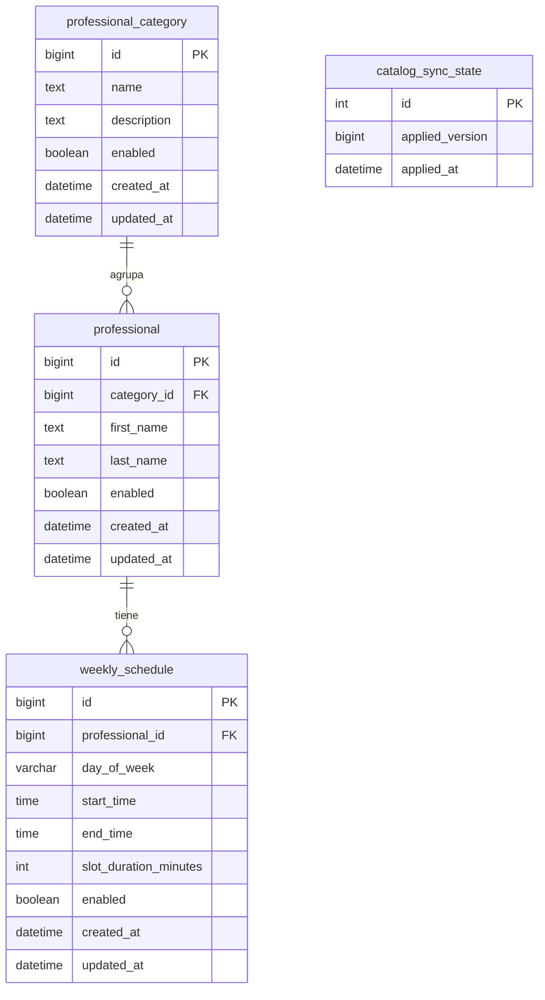

# Modelo de datos del catálogo

Este documento define el diseño de persistencia que se implementará en el servicio de catálogo. El servicio es propietario exclusivo de estas tablas. Los identificadores de categorías, profesionales y horarios se conservan tal como llegan desde la cátedra; no se generan IDs locales para esas entidades.

| Tabla | Contenido | Relación |
| --- | --- | --- |
| professional_category | Nombre, descripción opcional, habilitación y fechas de origen | Una categoría tiene varios profesionales |
| professional | Categoría, nombre, apellido, habilitación y fechas de origen | Referencia a professional_category |
| weekly_schedule | Profesional, día, hora inicial/final, duración del turno, habilitación y fechas | Referencia a professional |
| catalog_sync_state | Versión aplicada y momento de aplicación local | Una sola fila con id 1 |

## Reglas de persistencia

- La copia incluye entidades habilitadas y deshabilitadas; la baja lógica no elimina el registro.
- Las claves foráneas impiden horarios sin profesional y profesionales sin categoría. No hay borrado en cascada.
- Los días se guardan con los nombres del contrato (MONDAY a SUNDAY).
- Los horarios conservan hora local sin conversión de zona. Se exige fin posterior al inicio y duración positiva. La duración expresa minutos; no se añaden reglas de divisibilidad no especificadas por el contrato.
- Los instantes se representan con Instant y se almacenan en UTC con precisión de microsegundos. Los valores con mayor precisión se ajustan al límite de MySQL.
- Los campos de texto utilizan TEXT para no inventar límites de 50 o 100 caracteres que el anexo no define. La capacidad sigue limitada por el tipo de MySQL.
- applied_version y applied_at comienzan en NULL: aún no se aplicó un snapshot. La versión cero es válida y distinta de ese estado inicial.
- La actualización de la versión deberá bloquear la fila de sincronización dentro de una transacción. Datos y versión deberán actualizarse en la misma transacción, rechazando versiones negativas, retrocesos y fechas ausentes.

## Organización

Las clases Entity y los repositorios Spring Data JPA se ubicarán en `catalog.infrastructure.persistence`. Son componentes internos de persistencia, no respuestas REST. Los DTO y los casos de uso se incorporarán cuando se implementen los contratos y la sincronización.

## Migraciones previstas

La primera migración de producción será `V1__create_catalog.sql`. Reemplazará en las pruebas a `V1__setup_probe.sql`, que solo existe en bases temporales de test. Las pruebas deberán ejecutar el mismo esquema de producción. Una migración de producción aplicada no se editará: los cambios siguientes tendrán versiones nuevas.

## Criterios de verificación

- Guardar y recuperar categorías, profesionales y horarios con sus IDs de origen.
- Conservar registros deshabilitados y descripciones opcionales.
- Rechazar referencias inexistentes y horarios con duración no positiva o fin anterior al inicio.
- Distinguir la ausencia de sincronización de una versión cero aplicada.
- Revertir datos y versión juntos cuando una transacción falle.

## Alcance del diseño

Este documento no acredita una sincronización implementada. La carga de snapshots, las búsquedas HTTP y JWT se desarrollarán en etapas posteriores. La documentación de esta etapa puede revisarse antes de incorporar código, migraciones y pruebas.
